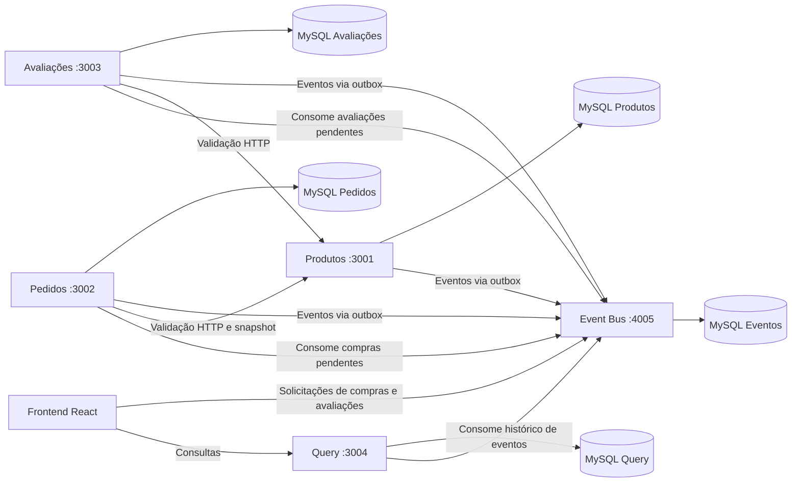

# ☕ Meow Coffee

Projeto da disciplina **Desenvolvimento Web 3 (DSW3)** — Arquitetura de Microsserviços.

Aplicação de cafeteria com catálogo, carrinho, compras e avaliações. O frontend é desenvolvido em React, e o backend é dividido em serviços independentes com bancos MySQL próprios.

## 1. Sobre o projeto

Produtos e Pedidos correspondem aos domínios principais do enunciado. Avaliações, Event Bus e Query ampliam a aplicação com comunicação assíncrona, filas persistentes e cópias dos dados para consulta.

| Componente | Pasta | Responsabilidade | Porta padrão |
| --- | --- | --- | --- |
| Produtos | `ms-produtos/` | Gerenciar o catálogo e publicar alterações | 3001 |
| Pedidos | `ms-pedidos/` | Processar compras e preservar snapshots | 3002 |
| Avaliações | `ms-avaliacoes/` | Processar notas e comentários | 3003 |
| Query | `ms-query/` | Consultar cópias de produtos, pedidos e avaliações | 3004 |
| Event Bus | `event-bus/` | Persistir eventos e solicitações pendentes | 4005 |
| Frontend | `frontend/` | Interface React servida pelo Nginx no Docker | 8080 |

## 2. Arquitetura



- **Bancos independentes:** cada serviço possui banco, usuário, rede de dados e volume próprios. Não há acesso direto ao banco de outro serviço nem chaves estrangeiras entre bancos.
- **Comunicação síncrona:** Pedidos consulta Produtos por HTTP para validar os itens e obter nome e preço. Avaliações também valida a existência do produto por HTTP.
- **Comunicação assíncrona:** os serviços publicam eventos no Event Bus, e o Query consome o histórico para atualizar suas cópias persistentes.
- **Outbox transacional:** a alteração e seu evento são salvos na mesma transação local. Eventos pendentes são reenviados quando o barramento volta.
- **Consistência eventual:** publicadores e consumidores executam em intervalos de 2 segundos. As alterações podem levar alguns segundos para aparecer no Query; o frontend atualiza catálogo e histórico a cada 5 segundos.

Mais detalhes em [docs/arquitetura.md](docs/arquitetura.md).

## 3. Estrutura do repositório

```text
ms-produtos/        API do catálogo, modelos, migrations e publicação de eventos
ms-pedidos/         API de compras, consumidor da fila, snapshots e eventos
ms-avaliacoes/      API de avaliações, consumidor da fila e eventos
event-bus/         Histórico de eventos e filas persistentes de solicitações
ms-query/          Projeções e consultas de produtos, pedidos e avaliações
frontend/          Interface React, estilos, imagens e configuração Nginx
docs/              Arquitetura e coleção do Postman
docker-compose.yml Serviços, bancos, redes e volumes
verify-query.mjs    Verificação de integração e recuperação após falhas
README.md          Instruções do projeto
```

## 4. Tecnologias utilizadas

- **Node.js 22+** e **Express** nas APIs.
- **Sequelize**, **mysql2** e **MySQL 8.4** para persistência.
- **Umzug** para migrations versionadas.
- **React**, **Vite** e **Axios** no frontend.
- **Fetch** nas integrações HTTP entre serviços.
- **Docker Compose** para execução conjunta e **Nginx** para servir o frontend e encaminhar chamadas às APIs.

## 5. Pré-requisitos e execução com Docker

Tenha o Docker Desktop iniciado, usando contêineres Linux. Não é necessário instalar Node.js ou MySQL no computador para executar pelo Docker.

Na raiz do repositório:

```powershell
docker compose up --build -d
```

Acesse **http://localhost:8080**. Aguarde os bancos iniciarem, as migrations serem aplicadas e o Query concluir a sincronização inicial. O catálogo de uma instalação nova começa vazio: cadastre produtos pela API ou pelo Postman.

Para acompanhar os serviços:

```powershell
docker compose ps
docker compose logs -f
```

Para encerrar preservando os bancos:

```powershell
docker compose down
```

**Não utilize a opção `-v` para um encerramento comum:** ela remove os volumes e seus dados.

## 6. Configuração e persistência

Para personalizar portas e senhas do Docker, copie o exemplo antes de iniciar e ajuste os valores:

```powershell
Copy-Item .env.example .env
```

O Compose configura cinco bancos: `meow_produtos`, `meow_pedidos`, `meow_avaliacoes`, `meow_eventos` e `meow_query`. Cada um utiliza um volume persistente separado.

As tabelas são criadas por migrations registradas na tabela `SequelizeMeta` de cada banco. Não é necessário executar scripts SQL manualmente. As migrations de adoção dos eventos incluem produtos, pedidos e avaliações preexistentes na outbox para sincronização com o Query.

As APIs oferecem `GET /health` para verificar o processo e `GET /ready` para verificar sua prontidão. No Query, a prontidão também considera a sincronização inicial.

## 7. Principais endpoints

| Serviço / porta | Método | Rota | Função |
| --- | --- | --- | --- |
| Produtos / 3001 | POST | `/produtos` | Cadastrar produto |
| Produtos / 3001 | GET | `/produtos` e `/produtos/:id` | Listar e consultar produtos na origem |
| Produtos / 3001 | PUT | `/produtos/:id` | Atualizar produto |
| Produtos / 3001 | DELETE | `/produtos/:id` | Excluir produto |
| Pedidos / 3002 | POST | `/pedidos` | Criar diretamente uma compra com validação e snapshot |
| Pedidos / 3002 | GET | `/pedidos` e `/pedidos/:id` | Listar e consultar compras na origem |
| Avaliações / 3003 | POST | `/avaliacoes` | Criar diretamente uma avaliação |
| Avaliações / 3003 | GET | `/avaliacoes?produtoId=UUID` | Listar avaliações de um produto |
| Avaliações / 3003 | GET | `/avaliacoes/media/:produtoId` | Consultar média e total |
| Query / 3004 | GET | `/produtos` e `/produtos/:id` | Consultar a projeção do catálogo |
| Query / 3004 | GET | `/pedidos` e `/pedidos/:id` | Consultar a projeção das compras |
| Query / 3004 | GET | `/avaliacoes?produtoId=UUID` | Consultar avaliações projetadas |
| Query / 3004 | GET | `/avaliacoes/media/:produtoId` | Consultar média e total projetados |
| Event Bus / 4005 | POST | `/events` | Receber eventos dos serviços |
| Event Bus / 4005 | GET | `/events?after=0&limit=100` | Consultar eventos por cursor para sincronização e replay |
| Event Bus / 4005 | POST | `/order-requests` | Receber uma solicitação de compra |
| Event Bus / 4005 | GET | `/order-requests` | Consultar solicitações de compra |
| Event Bus / 4005 | POST | `/order-requests/:id/retry` | Recolocar uma compra rejeitada na fila |
| Event Bus / 4005 | POST | `/order-requests/:id/remove` | Remover uma solicitação rejeitada |
| Event Bus / 4005 | POST | `/review-requests` | Receber uma solicitação de avaliação |
| Event Bus / 4005 | GET | `/review-requests?produtoId=UUID` | Consultar solicitações de avaliação por produto |

Os consumidores também utilizam rotas internas de confirmação de processamento: `POST /order-requests/:id/ack` e `POST /review-requests/:id/ack`.

O produto possui `id`, `nome`, `preco`, `descricao` e datas de criação e atualização. **A implementação atual não possui controle de estoque.**

## 8. Fluxo de compra e Snapshot Pattern

1. O cliente consulta o catálogo pelo Query e adiciona produtos ao carrinho.
2. O frontend envia os itens e um `requestId` ao Event Bus em `POST /order-requests`.
3. O barramento salva a solicitação no MySQL e responde **HTTP 202**, confirmando recebimento, ainda não a realização da compra.
4. O consumidor de Pedidos busca solicitações pendentes e aciona o processamento.
5. Pedidos consulta Produtos por HTTP e obtém o nome e o preço atuais de cada item.
6. Cabeçalho, itens e evento são salvos na mesma transação local. O consumidor confirma o processamento da solicitação.
7. O evento chega ao Query, que atualiza o histórico exibido pelo frontend.

Cada compra possui cabeçalho em `pedidos` e itens em `pedido_itens`. Cada item guarda `nomeProduto`, `precoUnitario`, `quantidade` e `valorTotal`. O **Snapshot Pattern** preserva esses dados mesmo se o catálogo mudar ou o produto for excluído.

O total é calculado em centavos e persistido como `DECIMAL`. A data é gerada pelo servidor em UTC. Produtos repetidos devem ter as quantidades somadas no carrinho; a API rejeita itens duplicados.

O `requestId` protege contra duplicação em reenvios. No `POST /pedidos`, reenviar o mesmo identificador com os mesmos itens recupera a compra existente com HTTP 200; itens diferentes com o mesmo identificador retornam HTTP 409.

## 9. Frontend e tolerância a falhas

O frontend possui catálogo, carrinho, histórico e avaliações, com validações de entrada, estados de carregamento e mensagens de erro.

Catálogo e histórico são consultados no **Query**, sem depender de cópias no `localStorage`. Compras e avaliações pendentes ficam no **MySQL do Event Bus** e podem ser processadas mesmo com o navegador fechado.

O carrinho ainda não enviado fica apenas na memória da página e é perdido ao recarregá-la. Se o Event Bus não confirmar o recebimento, a interface mantém o carrinho na página e apresenta erro. Não há importação automática de filas antigas do `localStorage`.

| Serviço indisponível | Comportamento esperado |
| --- | --- |
| Produtos | Query mantém as leituras sincronizadas; novas compras aguardam validação na fila |
| Pedidos | Query mantém o histórico; o Event Bus continua recebendo compras |
| Avaliações | Query mantém as avaliações sincronizadas; novas solicitações aguardam processamento |
| Event Bus | Novas solicitações não podem ser confirmadas; eventos não publicados permanecem nas outboxes |
| Query ou seu banco | As consultas do frontend ficam indisponíveis; não há fallback persistente no navegador |

Falhas temporárias mantêm solicitações pendentes. Erros de validação deixam compras aguardando revisão, com opções para tentar novamente ou remover da fila.

O histórico e as solicitações são globais, sem autenticação ou separação por cliente. O modelo de pedido admite `CANCELADO`, mas não há endpoint de cancelamento.

## 10. Documentação e testes das APIs

A coleção está em [docs/meow-coffee.postman_collection.json](docs/meow-coffee.postman_collection.json).

No Postman, utilize **Import → File** e selecione a coleção. Ajuste as variáveis de URL e copie o UUID de um produto cadastrado para `produtoId`. Troque identificadores de solicitação ao iniciar compras ou avaliações diferentes.

Exemplo de cadastro com `POST http://localhost:3001/produtos`:

```json
{
  "nome": "Espresso da Casa",
  "preco": 12.50,
  "descricao": "Café 100% arábica."
}
```

Exemplo de solicitação com `POST http://localhost:4005/order-requests`:

```json
{
  "requestId": "SUBSTITUA-POR-UM-NOVO-UUID",
  "itens": [
    {
      "produtoId": "SUBSTITUA-PELO-UUID-DO-PRODUTO",
      "quantidade": 2
    }
  ]
}
```

Para criar diretamente pela API de Pedidos, envie o mesmo formato a `POST http://localhost:3002/pedidos`. Essa chamada exige que Produtos esteja disponível naquele momento.

### Demonstração de falhas

Com o catálogo e o histórico já sincronizados, pare Pedidos:

```powershell
docker compose stop ms-pedidos
```

Confira as consultas e envie uma compra pela interface. Ela deve aparecer como pendente. Reinicie o serviço e acompanhe a atualização do histórico:

```powershell
docker compose start ms-pedidos
```

O mesmo teste pode ser realizado com `ms-produtos`. Restaure o serviço ao terminar.

### Verificação de integração

Com Node.js instalado, Docker disponível e serviços iniciados:

```powershell
node verify-query.mjs
```

O teste verifica sincronização, alterações e exclusões do catálogo, consultas durante quedas, persistência da fila após reinício, prevenção de duplicação, snapshot e persistência do Query. Ele interrompe e restaura serviços locais, remove o produto temporário e deixa uma compra de teste no histórico.

## 11. Desenvolvimento local sem Docker

Requer **Node.js 22+** e cinco bancos MySQL separados já criados. Em cada pasta de backend (`ms-produtos`, `ms-pedidos`, `ms-avaliacoes`, `event-bus` e `ms-query`), copie o exemplo, ajuste as credenciais e execute em terminais separados:

```powershell
Copy-Item .env.example .env
npm ci
npm run dev
```

Configure `EVENT_BUS_URL` nos serviços que publicam ou consomem eventos. Em Pedidos e Avaliações, configure também `PRODUTOS_API_URL` e, quando necessário, `PRODUTOS_TIMEOUT_MS`. Use `localhost` com as portas da tabela inicial. `CORS_ORIGINS` define as origens permitidas.

No frontend:

```powershell
cd frontend
Copy-Item .env.example .env
npm ci
npm run dev
```

As variáveis `VITE_QUERY_API_URL` e `VITE_EVENT_BUS_API_URL` configuram as consultas e o envio de solicitações. No Docker, o Nginx encaminha as chamadas pela mesma origem.

Para gerar a versão de produção, execute na pasta `frontend`:

```powershell
npm run build
```

## 12. Autoria

**Nome:** Nancy M. Yuzawa
