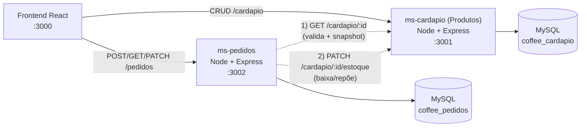

# ☕ Coffee.exe

Projeto da disciplina **Desenvolvimento Web 3 (DSW3)** — Arquitetura de Microsserviços.

**Descrição:** Desenvolvimento de um projeto prático aplicando os conceitos da arquitetura de microsserviços com a temática de uma **Cafeteria Tech**.

A aplicação é composta por dois microsserviços de backend independentes (**Cardápio** e **Pedidos**) e um frontend único desenvolvido em React.

## 1. Sobre o projeto

O sistema simula os pedidos de uma cafeteria e é composto por **dois microsserviços de backend independentes** e um **frontend em React** que os consome. A especificação da disciplina define os serviços genericamente como *Produtos* e *Pedidos*; neste repositório eles foram adaptados ao tema da aplicação, mantendo exatamente as mesmas responsabilidades e regras de negócio pedidas:

| Papel no enunciado da disciplina | Neste repositório     | Pasta         | Porta padrão |
|-----------------------------------|------------------------|---------------|:------------:|
| Microsserviço 1 — **Produtos**    | Cardápio (`ms-cardapio`) | `/ms-cardapio` | 3001         |
| Microsserviço 2 — **Pedidos**     | Pedidos (`ms-pedidos`)   | `/ms-pedidos`  | 3002         |
| Frontend (React)                  | Frontend (`frontend`)   | `/frontend`   | 3000         |

Ou seja: "produto" do enunciado = "item do cardápio" aqui (mesma entidade, mesmos campos e mesmas validações).

## 2. Arquitetura (Momento 1 · item 1)



Pontos-chave da arquitetura:

- **Cada microsserviço é dono do seu próprio banco.** Não existe *foreign key* de `pedidos.itemId` para o banco do cardápio — a relação é apenas lógica e é validada em tempo de execução via chamada HTTP.
- **Comunicação síncrona service-to-service:** ao criar um pedido, o `ms-pedidos` consulta o `ms-cardapio` para validar o item e obter os dados atuais antes de gravar qualquer coisa.
- **Snapshot Pattern:** o pedido grava `nomeItem` e `precoUnitario` no momento da compra, de modo que uma alteração futura de preço no cardápio não reescreve o histórico financeiro.

## 3. Estrutura do repositório

```
coffee-exe/
├── ms-cardapio/          # microsserviço "Produtos" da especificação
│   ├── database/          # schema.sql e seed.sql
│   └── src/                # config, models, controllers, routes
├── ms-pedidos/            # microsserviço "Pedidos"
│   ├── database/
│   └── src/                # inclui src/services/cardapioService.js (chamada HTTP ao cardápio)
├── frontend/               # aplicação React (escopo dos Momentos 3 e 4)
├── docs/
│   └── coffee-exe.postman_collection.json
└── README.md
```

## 4. Tecnologias utilizadas

- **Node.js 18+** com **Express** nos dois microsserviços;
- **Sequelize** (ORM) + **mysql2** sobre **MySQL 8**, um banco por serviço;
- **Axios** para a comunicação HTTP entre `ms-pedidos` e `ms-cardapio`;
- **React** (Create React App) no frontend — presente no repositório, mas fora do escopo avaliado nos Momentos 1 e 2.

## 5. Pré-requisitos

- Node.js 18 ou superior;
- MySQL 8.0.16 ou superior rodando localmente (os scripts usam `CHECK constraints`, que exigem essa versão);
- Postman ou Insomnia, para importar a coleção de testes da API.

## 6. Configuração do banco de dados (Momento 1 · item 4)

Cada serviço tem seu próprio schema. Execute uma vez cada script:

```bash
mysql -u root -p < ms-cardapio/database/schema.sql
mysql -u root -p < ms-pedidos/database/schema.sql
```

Isso cria os bancos `coffee_cardapio` e `coffee_pedidos` e as respectivas tabelas (`itens_cardapio` e `pedidos`), já com as constraints de integridade (preço/estoque não-negativos, quantidade positiva, enum de status, índices por CPF/status/item).

Para popular o cardápio com itens de exemplo (opcional, útil para testar/apresentar):

```bash
mysql -u root -p < ms-cardapio/database/seed.sql
# ou, após instalar as dependências do serviço:
npm run seed --prefix ms-cardapio
```

> Observação: cada serviço também tenta criar o banco e sincronizar as tabelas sozinho ao subir (via `sequelize.sync()`), mas os arquivos em `database/schema.sql` são a versão de referência para conferência da modelagem.

## 7. Variáveis de ambiente

Copie os arquivos de exemplo e ajuste usuário/senha do MySQL local:

```bash
cp ms-cardapio/.env.example ms-cardapio/.env
cp ms-pedidos/.env.example ms-pedidos/.env
```

`ms-cardapio/.env`
```
PORT=3001
DB_HOST=localhost
DB_PORT=3306
DB_NAME=coffee_cardapio
DB_USER=root
DB_PASSWORD=sua_senha_aqui
```

`ms-pedidos/.env`
```
PORT=3002
DB_HOST=localhost
DB_PORT=3306
DB_NAME=coffee_pedidos
DB_USER=root
DB_PASSWORD=sua_senha_aqui

# URL usada na comunicação service-to-service com o ms-cardapio
CARDAPIO_SERVICE_URL=http://localhost:3001
```

## 8. Como executar os microsserviços (Momento 1 · item 2)

**Opção A — a partir da raiz do repositório**, instalando e subindo tudo de uma vez:

```bash
npm run install:all   # instala ms-cardapio, ms-pedidos e frontend
npm run dev           # sobe os dois microsserviços (e o frontend) em paralelo
```

**Opção B — cada serviço individualmente** (recomendado para focar apenas no backend nesta entrega):

```bash
# terminal 1
cd ms-cardapio
npm install
npm run dev

# terminal 2
cd ms-pedidos
npm install
npm run dev
```

Ao subir corretamente, cada serviço expõe uma rota de status:

```
GET http://localhost:3001/  ->  { "servico": "ms-cardapio", "status": "online" }
GET http://localhost:3002/  ->  { "servico": "ms-pedidos",  "status": "online" }
```

## 9. Endpoints estruturados (Momento 1 · item 2)

### 9.1. `ms-cardapio` (Produtos) — base `http://localhost:3001/cardapio`

| Método | Rota                | Descrição                                             |
|--------|----------------------|--------------------------------------------------------|
| POST   | `/cardapio`          | Cadastra um novo item (nome, preço, descrição, estoque) |
| GET    | `/cardapio`          | Lista todos os itens cadastrados                        |
| GET    | `/cardapio/:id`      | Busca os detalhes de um item específico                 |
| PUT    | `/cardapio/:id`      | Atualiza um item existente                               |
| DELETE | `/cardapio/:id`      | Remove um item                                           |
| PATCH  | `/cardapio/:id/estoque` | Ajusta o estoque por delta (uso interno do `ms-pedidos`) |

**Entidade Item (Produto):** `id` (UUID), `nome` (string), `preco` (decimal ≥ 0), `descricao` (string, opcional), `estoque` (inteiro ≥ 0).

### 9.2. `ms-pedidos` — base `http://localhost:3002/pedidos`

| Método | Rota                     | Descrição                                                |
|--------|---------------------------|-------------------------------------------------------------|
| POST   | `/pedidos`                | Cria um novo pedido (valida e faz snapshot no cardápio)      |
| GET    | `/pedidos`                | Lista todos os pedidos                                        |
| GET    | `/pedidos?cpf=...`        | Lista somente os pedidos daquele CPF                          |
| GET    | `/pedidos/:id`            | Busca os detalhes de um pedido                                |
| PATCH  | `/pedidos/:id/cancelar`   | Cancela o pedido e devolve a quantidade ao estoque do cardápio |

**Entidade Pedido:** `id` (UUID), `nomeCliente`, `cpfCliente`, `itemId` (referência lógica ao produto), `nomeItem` (snapshot), `precoUnitario` (snapshot), `quantidade`, `valorTotal`, `dataPedido` (automática), `status` (`REALIZADO` | `CANCELADO`).

## 10. Comunicação service-to-service e Snapshot Pattern (Momento 2 · item 2)

Ao receber `POST /pedidos`, o `ms-pedidos` executa, nesta ordem:

1. **Validação local do payload** (`itemId`, `quantidade` inteira > 0, `nomeCliente` com ao menos 3 caracteres, `cpf` válido).
2. **`GET /cardapio/:itemId` no `ms-cardapio`** — confirma que o produto existe (`404` se não existir ou se o serviço estiver fora do ar) e obtém o **snapshot** atual de nome, preço e estoque.
3. **Verificação de estoque** — se a quantidade pedida for maior que o estoque disponível, retorna `400` sem gravar nada.
4. **`PATCH /cardapio/:itemId/estoque` com delta negativo** — baixa o estoque no `ms-cardapio` de forma atômica (transação com *row lock*), evitando que dois pedidos simultâneos consumam a mesma unidade em estoque; se o estoque acabou de ficar insuficiente entre os passos 2 e 4, o cardápio recusa com `409` e o pedido não é criado.
5. **Gravação do pedido** com `nomeItem` e `precoUnitario` fixados como snapshot — preservando o histórico financeiro mesmo que o preço do produto mude depois.
6. **Compensação:** se a gravação do pedido falhar após o estoque já ter sido baixado, o `ms-pedidos` chama novamente o `ms-cardapio` para repor a quantidade (não há transação distribuída entre os dois bancos, então essa é a forma de manter a consistência).

O cancelamento (`PATCH /pedidos/:id/cancelar`) faz o caminho inverso: repõe o estoque no cardápio e só então marca o pedido como `CANCELADO`.

**Resiliência:** se o `ms-cardapio` estiver fora do ar ou não responder a tempo, o `ms-pedidos` não quebra — ele responde `503` com uma mensagem amigável, sem deixar o pedido em estado inconsistente.

## 11. Documentação e testes das APIs (Momento 1 · item 3 / Momento 2 · item 4)

A coleção do Postman está em [`docs/coffee-exe.postman_collection.json`](./docs/coffee-exe.postman_collection.json), já com variáveis de ambiente (`cardapio_url`, `pedidos_url`, `itemId`, `pedidoId`, `nomeCliente`, `cpf`) e payloads de exemplo prontos.

Para importar: **Postman → Import → File** e selecione o arquivo acima.

A coleção está organizada em pastas, pensada para ser executada nesta ordem durante a apresentação prática:

1. **Cardápio (`ms-cardapio :3001`)** — criar, listar, buscar, atualizar e ajustar estoque de um item;
2. **Pedidos (`ms-pedidos :3002`)** — criar pedido, listar todos, listar por CPF, buscar por id, cancelar;
3. **Cenários de erro** — inclui, entre outros: pedido de produto inexistente (`404`), pedido sem estoque suficiente (`400`), quantidade zero/negativa (`400`), CPF inválido (`400`), cancelar pedido já cancelado (`409`);
4. **Resiliência** — derrubar o `ms-cardapio` e confirmar que a criação de pedido responde `503` de forma amigável, enquanto a listagem de pedidos continua funcionando normalmente;
5. **Limpeza** — remoção do item de teste criado na pasta 1.

## 12. Frontend

O diretório `/frontend` já contém uma aplicação React funcional que consome os dois microsserviços (catálogo, pedido, histórico e painéis administrativos), útil para testes ponta a ponta durante o desenvolvimento. Sua entrega formal, no entanto, corresponde aos **Momentos 3 e 4** do cronograma da disciplina, não sendo o foco desta entrega.

## 13. Autoria

**Nome:** _Nancy M. Yuzawa_
