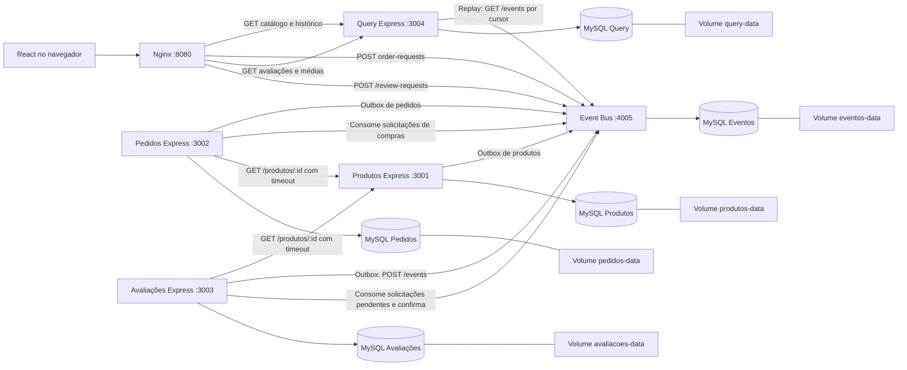

# Arquitetura

Cada serviço possui banco, usuário e volume próprios. Não existe FK entre os bancos.
Avaliações confirma a existência do produto por HTTP antes de gravar nota e comentário.
Listagem e média consultam apenas seu próprio banco e continuam disponíveis quando Produtos cai.
O modelo Avaliacao usa a tabela avaliacoes com id, produtoId, nota (1 a 5), comentario e criadoEm.

As leituras de produtos, pedidos e avaliações do frontend usam ms-query, com projeções persistentes em um banco independente. Produtos e Pedidos publicam suas mudanças por outbox transacional. O Query aplica atualizações e exclusões de produtos e criação de pedidos. As migrations incluem registros anteriores na outbox. A sincronização ocorre a cada 2 segundos.
Ao criar uma avaliação, ms-avaliacoes grava a avaliação e sua outbox na mesma transação.
Um publicador envia eventos AvaliacaoCriada ao Event Bus a cada 2 segundos; se o envio
ou a confirmação falhar, o mesmo UUID será reenviado. O barramento persiste os eventos
antes de responder e rejeita conteúdo diferente para um UUID existente.

Query busca eventos em lotes ordenados, a cada 2 segundos. Projeção e checkpoint são
gravados na mesma transação. Reenvio e replay não duplicam avaliações; a média é
calculada a partir da projeção. A primeira consulta só fica pronta após o replay inicial.
Em reinícios seguintes, a projeção já sincronizada pode ser consultada mesmo se o
barramento e Avaliações estiverem fora do ar. Não há leitura do banco de outro serviço.

Avaliações anteriores são incluídas na outbox pela migration 002. O histórico de
eventos permite reconstruir a projeção. Nenhuma dessas leituras depende de localStorage;
um navegador novo ou outro computador acessa os mesmos dados pelo servidor Query.
A atualização é eventual: uma gravação pode levar alguns segundos até chegar à consulta.
Query e seu banco precisam permanecer disponíveis para servir essas leituras.

O formulário envia novas avaliações para uma fila persistente no Event Bus. O retorno
202 confirma apenas o recebimento da solicitação. Com Avaliações parado, solicitações
continuam aceitas e visíveis por produto em outro computador. O consumidor de Avaliações
valida o produto, grava avaliação/outbox de forma idempotente pelo UUID da solicitação
e confirma o processamento. Quedas temporárias mantêm a solicitação pendente. A projeção
de Query e a média incluem somente avaliações efetivamente processadas.
Pedidos consulta Produtos por HTTP para validar todos os itens de uma compra e obter seus snapshots de nome/preço. O histórico usa somente o banco de Pedidos.

Com Produtos fora do ar, o histórico permanece disponível e novas compras recebem 503.
Com Pedidos fora do ar, o catálogo permanece disponível.
O frontend mostra loading e mensagens de erro com nova tentativa.

As migrations são registradas por Umzug na tabela SequelizeMeta de cada banco.
O schema é definido nos modelos Sequelize em src/database.js de cada serviço.
Não há criação de produtos de exemplo, alteração automática ou exclusão de dados existentes.

Produtos: id, nome, preco DECIMAL(10,2) e descricao.
Pedidos: id único da compra, valorTotal DECIMAL(14,2), dataPedido e status REALIZADO/CANCELADO.
Itens: chave composta (pedidoId, produtoId), nomeProduto, precoUnitario DECIMAL(10,2), quantidade e valorTotal DECIMAL(14,2).
Cabeçalho e itens são salvos na mesma transação MySQL após validar todos os produtos.
A migration 002 preserva os pedidos antigos como compras de um item.

O status CANCELADO permanece no modelo definido pelo documento; não há operação de cancelamento.
Timeouts e falhas SQL/HTTP são tratados sem encerrar a API.
Os volumes sobrevivem a docker compose down.

Compras pendentes ficam no MySQL do Event Bus em order-requests, sem localStorage. Pedidos consome essa fila mesmo sem navegador aberto. O HTTP 202 confirma recebimento, não realização da compra. O carrinho não enviado fica somente na memória da página. Falhas temporárias mantêm a solicitação pendente; rejeições permitem tentar novamente ou remover. As leituras já sincronizadas continuam disponíveis quando Produtos ou Pedidos ficam fora do ar.
